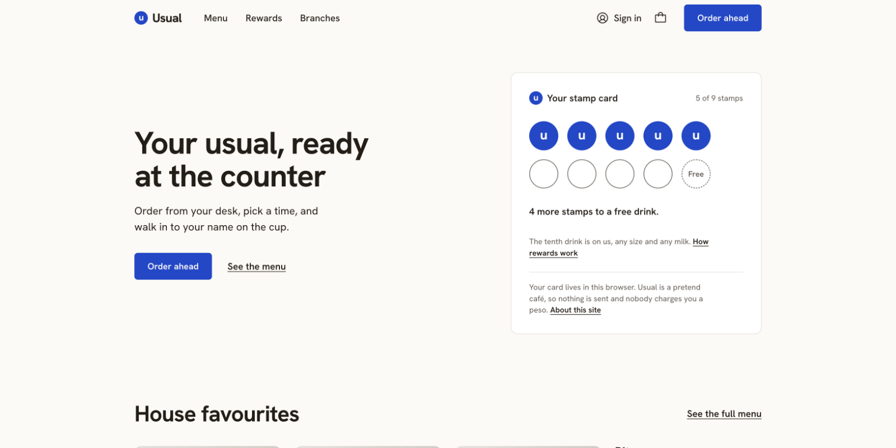
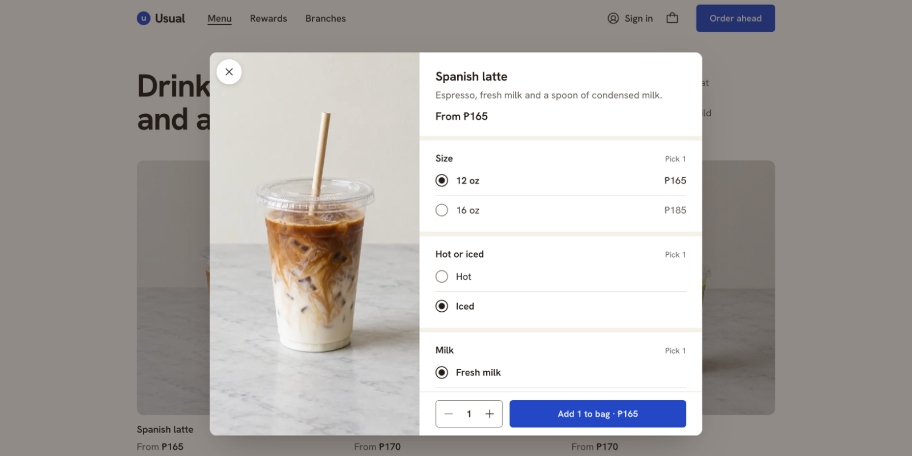
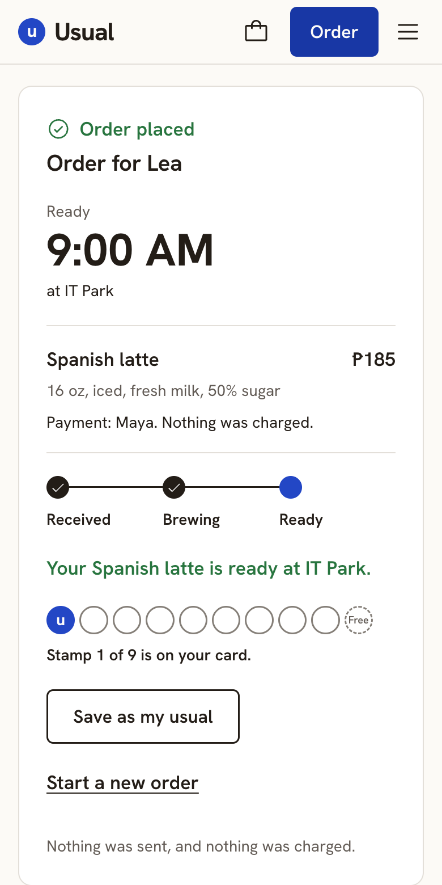
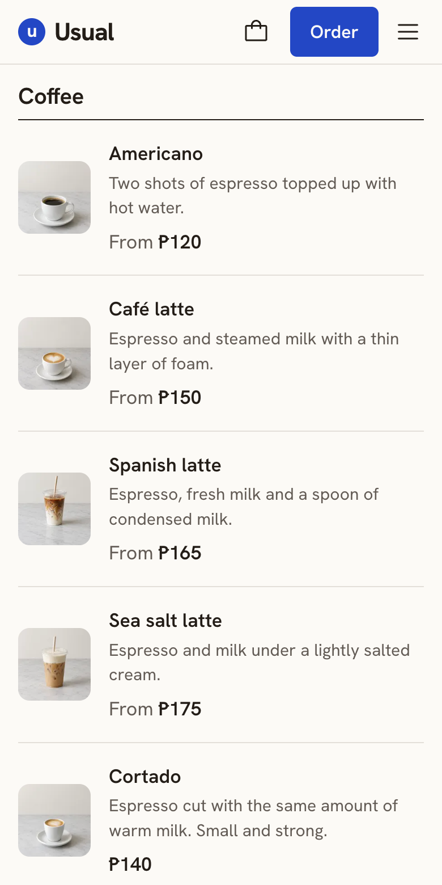

# Usual

Usual is a concept coffee bar with three branches in Cebu City: IT Park, open all night for the night shift, and Banilad and Capitol Site, open 7:00 AM to 10:00 PM. Its site lets you order ahead, fill an order bag, sign in with a one-time code, see your name on the cup, save your usual and collect stamps, and it markets the Usual app.

 

## Pages

- **Home** (`/usual/`): your own stamp card beside the headline, then the house favourites and bites (tap one to open its sheet), the seasonal Tablea, each branch open or closed right now with its earliest pickup, and the app.
- **Menu** (`/usual/menu/`): every drink, add-on and bite with its photo and price; tap one to choose how you want it and add it to your bag.
- **Order** (`/usual/order/`): the order builder.
- **Rewards** (`/usual/rewards/`): how the stamp card works, and your card.
- **Branches** (`/usual/branches/`): hours, open now and typical busy times.
- **Account** (`/usual/account/`): sign in, your saved usual and your stamp card.
- **Bag** (`/usual/bag/`): your items and checkout.
- **About**, **Contact** (with the FAQ), **Terms of Service**, **Privacy Policy**, **Cookie Policy** and **Accessibility**, linked from the footer.

## What you can do

- Build a drink step by step: drink, size, hot or iced, milk, sugar from 0 to 100%, extras, branch, pickup time and the name for the cup. The cup on screen pours each change and writes your name on the sleeve, and the price updates as you go.
- Pick a pickup time at a branch. Times start 10 minutes from now on the 5 and stop 15 minutes before closing. IT Park takes orders all night (times after midnight say "tomorrow"); a closed branch shows when it opens instead. A time you picked stays picked until it runs out; then the page tells you and asks for another.
- Choose GCash, Maya or card. Nothing is charged, and the site never asks for card or account numbers.
- Place the order and watch it go from received to brewing to ready (sped up for the demo), with each step announced for screen readers.
- Add drinks and bites to a bag from the menu, the favourites, the seasonal offer or the order builder, change quantities, and check out for one pickup. When the bag has items, the order page says so and offers "Add to bag" so everything goes in one order. Bag lines show the item's photo.
- Tap a drink or a bite on the menu or the favourites to open its sheet, laid out like a delivery app's item view (a bottom sheet on phones, the photo beside the choices on a desktop): choose the size, hot or iced, milk and sugar from lists of rows with their prices, tick extras such as an extra shot, write a note for the barista, set how many, and add it. The button shows the total as you go, and the bag shows the note.
- Sign in with your first name (an empty cup writes it on its sleeve as you type), your email or a mobile number and a one-time code that the page shows you. There is no password.
- Save an order as your usual and reorder it in one tap next time.
- Collect a stamp for every drink ordered ahead. Nine stamps earn a free tenth drink, which you can use on your next order.
- Check whether each branch is open right now and how busy it usually is at this hour.
- Read the menu with both sizes and every add-on, with a photo of every drink and bite.
- See on Home how many stamps you have and how many are left to a free drink, and in the footer of every page which branches are open right now.
- Write to the café through the contact form; it says plainly that nothing was sent.

All times are Cebu time (Asia/Manila), wherever you open the page.

## What's real

Usual doesn't exist. The site is built as the real product would be, so it names no author. A short note beside the main action on Home (at the foot of the stamp card) and on Order says it is a demonstration, the footer's "About this site" link opens a note explaining it, and the Terms page states it: "Usual is a concept brand. This is a demonstration site: nothing you enter here is sent, and no payments are taken." There are no branches to visit and the app isn't in any store. Orders, sign-ins and messages stay in your browser: the saved usual, the stamp card, the bag and the signed-in first name are kept in localStorage (`usual:usual`, `usual:card`, `usual:bag`, `usual:account`). If your browser blocks site data, everything still works and is simply forgotten when you leave. There are no real accounts, payments, analytics or cookies.

Busy times come from a fixed typical day for each branch, labelled as typical, not live. The photographs are generated images: every drink and bite on the menu photographed on the same wall and counter, plus a hero shot and a barista's hands.

## Design

Usual has its own design system, "Blue Stamp": a warm-white page, near-black type, daylight photographs of drinks, and one stamp-pad blue for the primary action and the loyalty stamps, set in Hanken Grotesk and built with Tailwind CSS.

## License

The code is released under the [MIT License](LICENSE). Hanken Grotesk is under the SIL Open Font License 1.1; Phosphor icons and Tailwind CSS are MIT. The photographs were generated with Figma’s AI image generation (OpenAI gpt-image-2.5-flare); see [REFERENCES.md](REFERENCES.md).

Running it locally or changing it? See [DEVELOPMENT.md](DEVELOPMENT.md).
